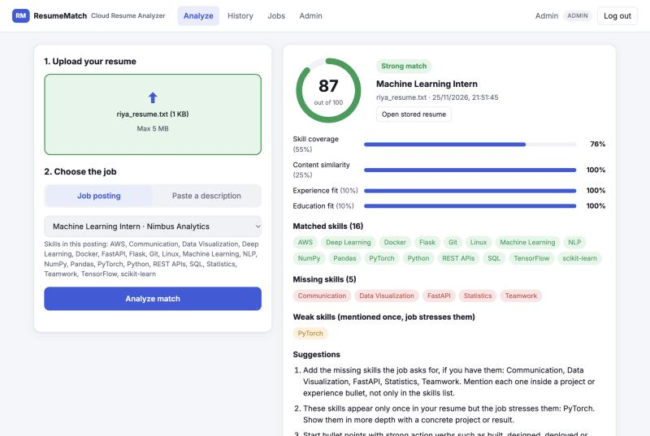
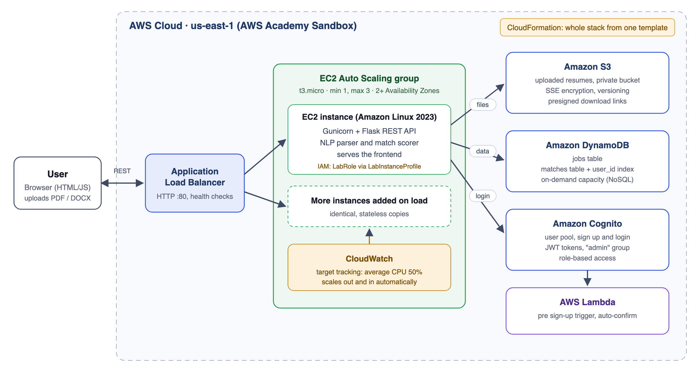

# Cloud-Based AI Resume Analyzer and Job Matching System

Upload a resume, pick a job, and get a match score with a clear list of what is missing and how to improve it. The app runs on AWS: EC2 Auto Scaling behind a load balancer, with S3, DynamoDB, Cognito and Lambda. One CloudFormation template creates the whole stack.


<p align="center">
  
</p>

**Team:** Agampreet Kaur, Devansh Sharma, Furmaan Kaur (UCS531 Cloud Computing, Thapar Institute, Lab L430)

## Contents

- [Features](#features)
- [Architecture](#architecture)
- [How the matching works](#how-the-matching-works)
- [Tech stack](#tech-stack)
- [Run locally](#run-locally)
- [Deploy to AWS](#deploy-to-aws-academy-sandbox)
- [Demo script](#demo-script)
- [REST API](#rest-api)
- [Project layout](#project-layout)
- [Documents](#documents)

## Features

- **Resume parsing:** reads PDF, DOCX and TXT files and pulls out skills, sections, years of experience, degree and contact details.
- **Job matching:** scores a resume from 0 to 100 against a saved job posting or any pasted job description.
- **Skill-gap report:** matched, missing and weak skills, grouped by category, plus missing job keywords.
- **Suggestions:** specific tips such as adding missing skills, numbers in achievements, action verbs and missing sections.
- **History:** every analysis is saved; the original resume can be reopened through a short-lived S3 link.
- **Roles:** normal users see their own history. Admins can post and delete jobs, see everyone's history and view stats.
- **Elastic:** adds EC2 instances automatically when CPU passes 50%; the page footer shows which instance answered.
- **Runs anywhere:** the same code runs on a laptop (SQLite, local files) or on AWS (DynamoDB, S3, Cognito).

## Architecture



| Cloud service | Role in the project |
|---|---|
| EC2 + Auto Scaling + ALB | Runs the backend; adds instances when CPU passes 50% |
| S3 | Stores uploaded resumes (private, encrypted, versioned) |
| DynamoDB | Job postings and match history (NoSQL, GSI on user_id) |
| Cognito + IAM LabRole | User accounts, `admin` group for role-based access, no keys in code |
| Lambda | Auto-confirms new sign-ups |
| REST API (Flask) | Connects the frontend, matcher, storage and database |
| CloudFormation | Rebuilds the full stack in about 5 minutes |
| CloudWatch | CPU metrics and scaling alarms |

A request goes from the browser to the load balancer and on to an EC2 instance. The API checks the Cognito token, saves the file in S3, scores it, stores the result in DynamoDB and returns JSON. The instances keep no data of their own, so any of them can answer any request.

## How the matching works

1. Text is pulled from the PDF (pypdf) or DOCX (python-docx).
2. About 140 skills are detected using a dictionary with aliases (for example `sklearn` means scikit-learn), with word-boundary rules so `JavaScript` does not count as `Java`.
3. Sections, years of experience (from date ranges like `May 2025 - July 2025`), highest degree and contact details are extracted.
4. The score is calculated:

   ```
   score = 0.55 x skill coverage
         + 0.25 x content similarity   (cosine similarity of word vectors)
         + 0.10 x experience fit
         + 0.10 x education fit
   ```

5. Output: matched, missing and weak skills, plus up to eight suggestions.

## Tech stack

| Layer | Tools |
|---|---|
| Frontend | HTML, CSS, vanilla JavaScript (single page) |
| Backend | Python, Flask, Gunicorn |
| NLP | pypdf, python-docx, skill dictionary, cosine similarity |
| Cloud | EC2, Auto Scaling, ALB, S3, DynamoDB, Cognito, Lambda, CloudWatch, IAM |
| Infrastructure as code | AWS CloudFormation, bash deploy scripts |
| Testing | unittest, threaded load test script |

## Run locally

```bash
git clone https://github.com/agamlotey/ai-resume-analyzer.git
cd ai-resume-analyzer
python3 -m venv .venv
.venv/bin/pip install -r backend/requirements.txt
cp .env.example .env
.venv/bin/python backend/app.py
```

Open http://localhost:5050. The admin account comes from `.env` (`ADMIN_EMAIL` / `ADMIN_PASSWORD`). Any new sign-up gets the normal `user` role. Sample resumes and a job description are in `samples/`.

The same code runs in two modes, chosen by `APP_MODE`:

| | `local` (laptop) | `aws` (cloud) |
|---|---|---|
| Files | `data/uploads/` | S3 |
| Database | SQLite `data/app.db` | DynamoDB |
| Login | JWT signed by the app | Amazon Cognito |

Run the tests:

```bash
.venv/bin/python -m unittest discover tests -v
```

## Deploy to AWS Academy Sandbox

The Sandbox deletes everything when the session timer ends, so the whole stack is created from code each time.

1. In AWS Academy open **Sandbox**, click **Start Lab** and wait for the dot to turn green.
2. Open AWS CloudShell in the console (region **us-east-1**).
3. Get the code and deploy:

   ```bash
   git clone https://github.com/agamlotey/ai-resume-analyzer.git
   cd ai-resume-analyzer
   ADMIN_PASSWORD='<8+ chars, upper, lower, number>' ./infra/deploy.sh
   ```

4. After about 5 to 8 minutes the script prints the app URL (`http://resume-analyzer-alb-....elb.amazonaws.com`).
5. When you are done, delete everything:

   ```bash
   ./infra/teardown.sh
   ```

If a deploy fails and the stack is stuck in `ROLLBACK_COMPLETE`, run `./infra/teardown.sh` and deploy again. To see an instance's setup log, connect to it with Session Manager (EC2 console, Connect) and run `sudo cat /var/log/app-setup.log`.

## Demo script

1. Show the CloudFormation stack and its resources in the console.
2. Sign up as a new user, upload `samples/resume_ml_student.pdf` and match it to "Machine Learning Intern" (around 85+), then to "Full Stack Developer" (much lower).
3. Open History, then "Open stored resume" (served from S3 through a presigned URL). Show the object in S3 and the item in DynamoDB.
4. Show the new user in the Cognito user pool.
5. Log in as admin: post a new job, show "Show all users" in History and the Admin stats.
6. Elasticity: run the load test from CloudShell and watch the Auto Scaling group add instances, with requests spread across instance IDs:

   ```bash
   python3 scripts/load_test.py http://<alb-dns> --password '<admin password>' --threads 30 --minutes 8
   ```

## REST API

| Method | Path | Who | What |
|---|---|---|---|
| GET | `/api/health` | anyone | Status, mode and the instance that answered |
| POST | `/api/auth/register` | anyone | Create account, returns token |
| POST | `/api/auth/login` | anyone | Returns token |
| GET | `/api/auth/me` | user | Current user |
| GET | `/api/jobs` | user | List job postings |
| POST | `/api/jobs` | admin | Create a job posting (skills are extracted automatically) |
| DELETE | `/api/jobs/<id>` | admin | Delete a job posting |
| POST | `/api/analyze` | user | Multipart: `resume` file + `job_id` or `job_description` |
| GET | `/api/matches` | user | Own history (`?all=1` for admin) |
| GET | `/api/matches/<id>` | owner/admin | Full result |
| GET | `/api/matches/<id>/resume` | owner/admin | Stored resume file (presigned S3 URL in AWS mode) |
| GET | `/api/stats` | admin | Totals and most common missing skills |

## Project layout

```
backend/   Flask API (app.py), NLP (nlp.py, skills.py), storage/database/auth adapters, seed data
frontend/  Single-page UI (HTML, CSS, vanilla JS), served by the backend
infra/     CloudFormation template, deploy.sh, teardown.sh
docs/      Report, presentation, architecture diagram
samples/   Sample resumes (PDF, DOCX) and a job description for the demo
scripts/   load_test.py (shows auto scaling), make_samples.py
tests/     Unit and API tests
```

## Documents

- [Project report (PDF)](docs/AI_Resume_Analyzer_Report.pdf)
- [Presentation (PDF)](docs/AI_Resume_Analyzer_Presentation.pdf)
- [Architecture diagram (SVG)](docs/architecture.svg)
