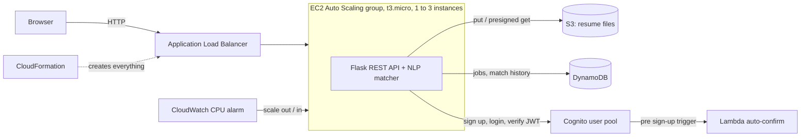

# Cloud-Based AI Resume Analyzer and Job Matching System

UCS531 Cloud Computing project. Users upload a resume (PDF/DOCX), pick a job posting or paste a job description, and get a match score, a skill-gap breakdown and suggestions. The app runs on AWS: EC2 Auto Scaling behind a load balancer, S3 for resumes, DynamoDB for data and Cognito for login, all created by one CloudFormation template.

Team: Agampreet Kaur, Devansh Sharma, Furmaan Kaur (Lab L430).

## Architecture



| Cloud service | Role in the project | UCS531 topic |
|---|---|---|
| EC2 + Auto Scaling + ALB | Runs the backend; adds instances when CPU passes 50% | Elastic Compute Cloud, elasticity, XaaS |
| S3 | Stores uploaded resumes (private, encrypted, versioned) | Simple Storage Service, cloud storage |
| DynamoDB | Job postings and match history (NoSQL, GSI on user_id) | NoSQL databases, data replication |
| Cognito + IAM LabRole | User accounts, `admin` group for role-based access, no keys in code | Identity management and security |
| Lambda | Auto-confirms new sign-ups | Serverless computing |
| REST API (Flask) | Connects the frontend, matcher, storage and database | RESTful web services |
| CloudFormation | Rebuilds the full stack in about 5 minutes | Infrastructure as code |
| CloudWatch | CPU metrics and scaling alarms | Monitoring |

## How the matching works

1. Text is pulled from the PDF (pypdf) or DOCX (python-docx).
2. About 140 skills are detected using a dictionary with aliases (for example `sklearn` means scikit-learn), with word-boundary rules so `JavaScript` does not count as `Java`.
3. Sections, years of experience (from date ranges like `May 2025 - July 2025`), highest degree and contact details are extracted.
4. Score = 55% skill coverage + 25% content similarity (cosine similarity of word vectors) + 10% experience fit + 10% education fit.
5. Output: matched, missing and weak skills, plus suggestions (missing skills, numbers in achievements, action verbs, missing sections, job keywords).

## Project layout

```
backend/   Flask API (app.py), NLP (nlp.py, skills.py), storage/database/auth adapters, seed data
frontend/  Single-page UI (HTML, CSS, vanilla JS), served by the backend
infra/     CloudFormation template, deploy.sh, teardown.sh
docs/      Project report (DOCX, PDF), presentation (PPTX, PDF), architecture diagram
samples/   Sample resumes (PDF, DOCX) and a job description for the demo
scripts/   load_test.py (shows auto scaling), make_samples.py
tests/     Unit and API tests
```

The same code runs in two modes, chosen by `APP_MODE`:

| | `local` (laptop) | `aws` (cloud) |
|---|---|---|
| Files | `data/uploads/` | S3 |
| Database | SQLite `data/app.db` | DynamoDB |
| Login | JWT signed by the app | Amazon Cognito |

## Run locally

```bash
cd ai-resume-analyzer
python3 -m venv .venv
.venv/bin/pip install -r backend/requirements.txt
cp .env.example .env
.venv/bin/python backend/app.py
```

Open http://localhost:5050. The admin account comes from `.env` (`ADMIN_EMAIL` / `ADMIN_PASSWORD`). Any new sign-up gets the normal `user` role.

Run the tests:

```bash
.venv/bin/python -m unittest discover tests -v
```

## Deploy to the AWS Academy Sandbox

The Sandbox deletes everything when the session timer ends, so the whole stack is created from code each time.

1. In AWS Academy open **Sandbox**, click **Start Lab**, wait for the dot to turn green.
2. Open the lab terminal (or AWS CloudShell in the console, region **us-east-1**).
3. Get the code there and deploy:

   ```bash
   git clone <your GitHub repo URL> ai-resume-analyzer
   cd ai-resume-analyzer
   ADMIN_PASSWORD='<pick one: 8+ chars, upper, lower, number>' ./infra/deploy.sh
   ```

   Without GitHub you can upload a zip of the folder in CloudShell (Actions, Upload file) and unzip it.
4. After about 5 to 8 minutes the script prints the app URL (`http://resume-analyzer-alb-....elb.amazonaws.com`). The footer of the page shows which EC2 instance served you.
5. When you are done, run `./infra/teardown.sh` to save budget.

If a deploy fails and the stack is stuck in `ROLLBACK_COMPLETE`, run `./infra/teardown.sh` and deploy again. To see an instance's setup log, connect to it with Session Manager (EC2 console, Connect) and run `sudo cat /var/log/app-setup.log`.

## Demo script

1. Show the CloudFormation stack and its resources in the console.
2. Sign up as a new user, upload `samples/resume_ml_student.pdf`, match it to "Machine Learning Intern" (around 85+), then to "Full Stack Developer" (much lower).
3. Open History, then "Open stored resume" (served from S3 through a presigned URL). Show the object in the S3 console and the item in the DynamoDB console.
4. Show the new user in the Cognito user pool.
5. Log in as admin: post a new job, show "Show all users" in History and the Admin stats.
6. Elasticity: run the load test from the lab terminal and watch the Auto Scaling group add instances (takes a few minutes), and the requests spread across instance IDs:

   ```bash
   python3 scripts/load_test.py http://<alb-dns> --password '<admin password>' --threads 30 --minutes 8
   ```

## REST API

| Method | Path | Who | What |
|---|---|---|---|
| GET | `/api/health` | anyone | Status, mode and the instance that answered |
| POST | `/api/auth/register` | anyone | Create account, returns token |
| POST | `/api/auth/login` | anyone | Returns token |
| GET | `/api/auth/me` | user | Current user |
| GET | `/api/jobs` | user | List job postings |
| POST | `/api/jobs` | admin | Create a job posting (skills are extracted automatically) |
| DELETE | `/api/jobs/<id>` | admin | Delete a job posting |
| POST | `/api/analyze` | user | Multipart: `resume` file + `job_id` or `job_description` |
| GET | `/api/matches` | user | Own history (`?all=1` for admin) |
| GET | `/api/matches/<id>` | owner/admin | Full result |
| GET | `/api/matches/<id>/resume` | owner/admin | Stored resume file (presigned S3 URL in AWS mode) |
| GET | `/api/stats` | admin | Totals and most common missing skills |
